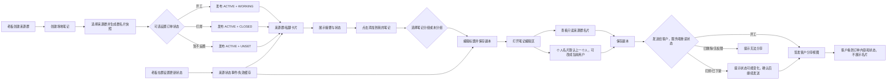
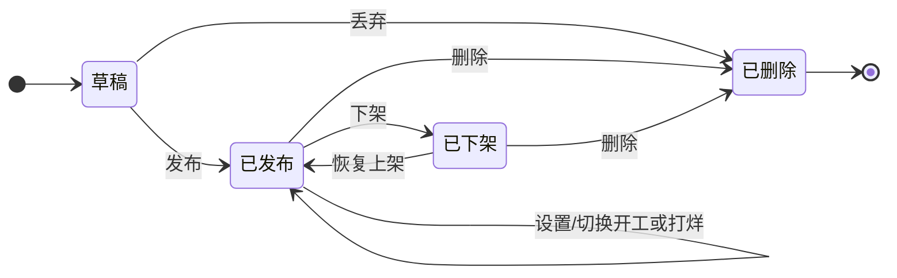
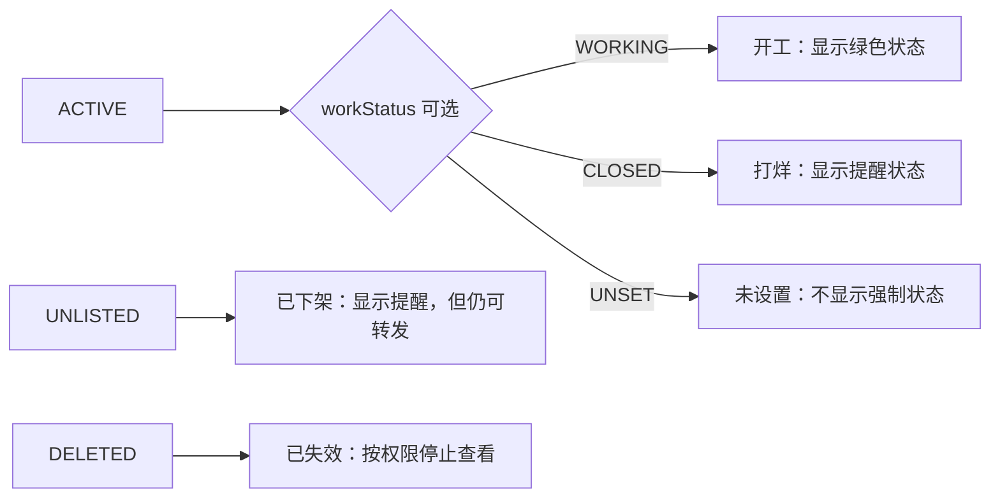
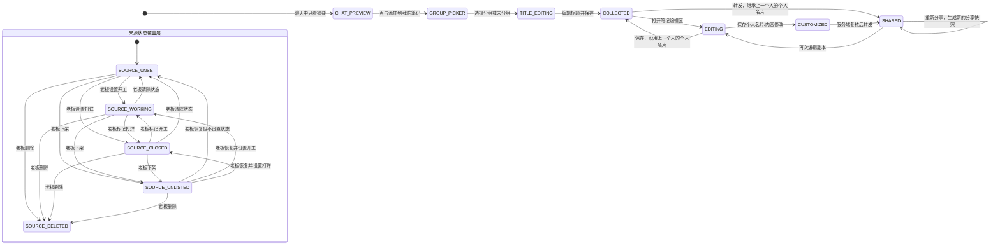
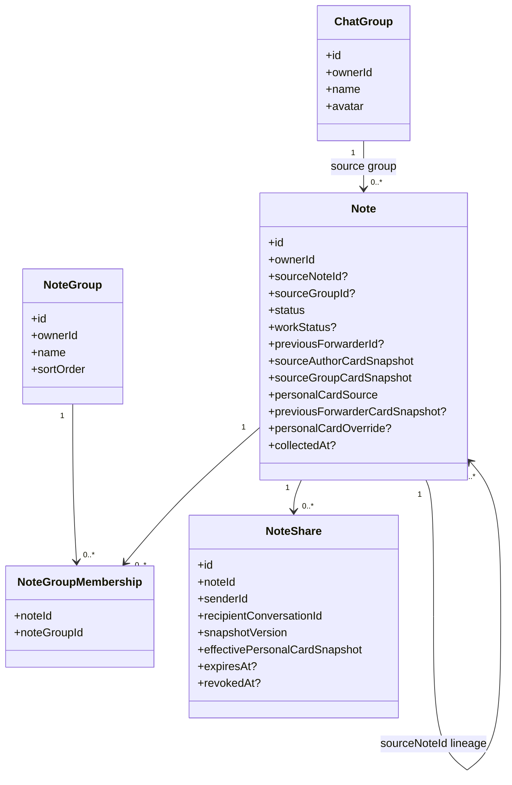

# 笔记群名片与场地状态机设计

- 日期：2026-10-09
- 状态：设计基线，供前后端实现与评审使用
- 范围：老板发布场地笔记、盯单收录与编辑、客户查看、群设置里的笔记管理

## 1. 先把两个“群”分开

当前产品里有两个容易混淆的概念，后续文案、路由、接口和数据字段都按下面的名称使用：

| 名称 | 含义 | 是否公开 | 例子 |
| --- | --- | --- | --- |
| **来源群（Source Chat Group）** | 老板创建并发布场地笔记的真实聊天群。群名片属于这个群。 | 群成员可见；笔记卡片只展示摘要 | “上海场地资源群” |
| **笔记分组（My Note Group）** | 每个用户自己的笔记整理目录。盯单添加笔记时选择它。 | 仅当前用户可见 | “待跟进”“上海”“本周空场” |

“群名片”始终指来源群的名片；“笔记分组”永远不渲染到聊天卡片，也不会随笔记发给客户。

## 2. 当前实现盘点

这次设计建立在仓库现有能力之上：

| 已有能力 | 当前位置 | 设计中的处理 |
| --- | --- | --- |
| `NoteStatus = ACTIVE / UNLISTED / DELETED` | `src/features/notes/types.ts` | 继续作为发布生命周期；增加明确的可用状态展示 |
| `NoteSummary.available` | `src/features/notes/types.ts` | 作为兼容字段；新语义使用可选的“开工/打烊”状态，不能只靠复制品快照 |
| 多个私人笔记分组、分组排序 | `src/services/api/notes.ts`、`src/features/notes/screens/NotesScreen.tsx` | 继续使用，收录时增加目标分组选择 |
| `collectNote` 与 `collectedFrom` 来源快照 | `src/services/api/notes.ts`、`src/features/notes/types.ts` | 扩展为“来源笔记 + 目标笔记分组 + 来源状态”的收录模型 |
| 笔记内联系人卡和群卡区块 | `src/features/notes/types.ts`、`src/features/notes/utils/note-sections.ts` | 不再把任意内容里的群卡误当成来源群名片；新增独立的来源群卡字段 |
| 聊天笔记卡片只带摘要 | `src/types/index.ts`、`src/features/chat/utils/note-card-payload.ts` | 群聊和私聊的渲染投影都不展示个人卡和群卡；内部消息只携带服务端校验的隐藏快照供收藏/转发继承 |
| 来源 chip、来源跳转 | `src/features/notes/components/NoteCard.tsx` | 保留用于盯单回看来源；增加开工/打烊/下架状态标识 |
| `NoteCardData` 当前只有摘要字段，且带有 `groupNames` | `src/types/index.ts`、`src/features/chat/utils/note-card-payload.ts` | 增加可选 `workStatus`，旧消息按 `UNSET` 兼容；聊天投影移除私人 `groupNames`，仍不返回两种名片 |
| 群设置已有群主权限区 | `src/features/chat/screens/GroupManageScreen.tsx` | 在“群主”区域增加“笔记管理”入口，仅群主可见 |

## 3. 产品概念与不可变规则

### 3.1 一条来源笔记和多条收录副本

一条笔记有一个权威来源：老板的来源笔记。盯单收录时创建自己的副本，副本带 `sourceNoteId` 指向来源笔记。一个来源可以有多个盯单副本。

- 老板是来源笔记的 `sourceOwner`，可以管理来源群、场地状态和发布状态。
- 盯单是收录副本的 `owner`，可以编辑自己的内容、个人名片和笔记分组。
- 群设置里的来源群关联和开工/打烊状态只作用于老板创建的来源笔记，不作用于收录副本。
- 客户只接触盯单发送的分享视图，不拥有来源笔记或盯单副本。
- 来源状态必须实时回到来源笔记判断；副本不能把“曾经开工”当成当前开工。

### 3.2 两种名片

**来源群名片**：老板发布时选择的来源群名片快照。

- 创建/发布时确定，带 `groupId、name、avatar` 快照。
- 盯单副本中只读，盯单不能替换成自己的群。
- 群名片只在笔记编辑区作为只读来源信息使用；聊天卡片、笔记详情页和客户分享视图都不渲染它。
- 老板在群设置里管理的是来源笔记和来源群绑定；若允许改绑，必须生成新的来源版本，旧副本仍保留原群快照。首版建议发布后不改绑，改绑走“下架旧笔记并重新发布”。

**个人名片**：笔记上展示的个人联系人卡。

- 默认值是来源笔记作者（老板）的个人名片快照。
- 盯单可以在笔记编辑区改成自己的个人名片或编辑卡片内容。
- 每次新收录/转发优先继承上一份订单分享中的 `effectivePersonalCardSnapshot`；如果是第一份来源订单且没有上一份快照，才回退到老板的来源作者卡。当前用户编辑后，该编辑后的卡才会成为下一次转发的默认卡。
- 保存时记录 `INHERITED` 或 `OWNER_OVERRIDE`，不覆盖来源作者快照。
- 个人名片只在编辑区可见；聊天卡片、笔记详情页和客户分享视图都不渲染它。

### 3.3 聊天卡片和笔记详情的隐私边界

- 群聊和私聊里的聊天笔记卡片只展示标题、摘要、封面、内容类型和场地状态。
- 聊天卡片的渲染投影不带个人名片、群名片、笔记分组、来源私聊信息或完整内容；消息内部可带服务端写入的不可变名片快照，仅供再次转发和收藏使用。
- 打开的笔记详情页展示正文、媒体、位置、来源状态、备注等其他信息，但不展示个人名片和群名片。
- 老板和盯单只有进入笔记编辑区后才能看到名片编辑区；来源群名片只读，个人名片可编辑。
- 客户打开盯单发出的分享视图时也只看到订单内容和状态，不看到两种名片。
- 笔记列表/详情和只读客户视图必须省略这些字段；聊天消息里的快照字段由服务端生成并由客户端严格清洗，不能作为界面展示数据。
- 现有 `collectedFrom.sender/group` 只保留为来源链路的服务端快照；普通 `NoteSummary/NoteDetail` 响应不得把它们作为可展示名片返回。

## 4. 端到端业务流程



### 4.1 老板流程

1. 在自己的来源群创建场地笔记，填写场地介绍。
2. 在发布前选择来源群；系统保存群名片快照，个人名片默认取老板名片。
3. 可以选择设置“开工”或“打烊”，也可以暂不设置；状态是给盯单和客户的提醒，不是发布前的必填项。
4. 发布后，老板可以在来源群设置的“笔记管理”里查看自己关联的笔记。
5. 老板可以切换开工/打烊，也可以清除状态、下架/恢复；每次操作都记录更新时间并触发来源状态刷新。

### 4.2 盯单流程

1. 在任意能看到笔记摘要的聊天里点击“添加到我的笔记”。
2. 弹出“选择笔记分组”，只列出当前用户自己的笔记分组；取消则不收录。
3. 先选择自己的笔记分组或“未分组”，然后打开标题编辑框。
4. 标题默认是“分组名 + 当前用户名 + 原标题”，盯单可以修改后保存；保存才创建副本。
5. 服务端创建盯单副本，写入 `sourceNoteId`、目标笔记分组、标题和上一个人的个人名片快照。
6. 盯单进入笔记编辑区：来源群名片是只读的；个人名片默认沿用上一个人的卡，可以改成自己的卡。
7. 保存后再发给客户。发送接口读取最新来源状态；打烊只触发提醒，不禁用发送，未设置不弹强提醒。

### 4.3 客户流程

1. 客户在群里提出找场地的需求。
2. 客户看到的来源群或私聊笔记卡片只有摘要和开工/打烊状态，不会看到名片。
3. 盯单把已经收录、必要时已编辑的副本发给客户。
4. 客户打开服务端签发的分享视图后，看到场地内容、订单状态、媒体、位置和其他正文信息，不看到两种名片。
5. 客户不能修改来源状态、来源群名片、盯单的笔记分组或来源笔记正文。

## 5. 状态机

### 5.1 来源笔记的发布状态和订单状态是两个维度

不要把“开工/打烊”和“下架”塞进同一个布尔字段。发布生命周期和订单状态独立变化，订单状态可以为空：



`ACTIVE` 下面再带一个可选的 `workStatus`：



状态规则：

| 状态 | 来源群聊天卡片 | 盯单副本 | 是否允许新发给客户 |
| --- | --- | --- | --- |
| `ACTIVE + WORKING` | 显示“开工”状态 | 显示“开工”状态 | 允许 |
| `ACTIVE + CLOSED` | 显示“打烊”提醒 | 显示“打烊”提醒 | 允许，发送前提醒 |
| `ACTIVE + UNSET` | 不强制显示状态 | 显示“状态未设置”提示 | 允许，不弹强提醒 |
| `UNLISTED` | 标“已下架”，新读取遵守现有权限 | 已有副本标“来源已下架” | 已有副本发送前提醒；新读取仍按权限 |
| `DELETED` | 详情不可用或显示已失效 | 标“来源已失效”，不再展示可操作内容 | 停止新的分享 |

`WORKING/CLOSED/UNSET` 只是订单状态提示，不是发送权限。老板不设置状态时也能发布；打烊只在发送前提醒“订单状态可能已经变化，是否继续发送”，未设置不弹强提醒。下架仍是发布生命周期控制，已有副本可按权限继续处理，新读取遵守现有授权。

### 5.2 盯单副本的收录与名片状态



副本的编辑状态不改变来源状态。来源覆盖层变化后，副本马上刷新状态徽标；工作状态为打烊时，分享接口返回提醒信息但仍允许转发，未设置不弹强提醒。下架的新读取遵守权限，来源删除或当前用户没有查看权限时停止新的分享。

### 5.3 名片可见性状态

| 场景 | 个人名片 | 来源群名片 | 说明 |
| --- | --- | --- | --- |
| 群聊或私聊笔记卡片 | 隐藏 | 隐藏 | 展示其他摘要、媒体计数和订单状态 |
| 老板/盯单打开笔记详情 | 隐藏 | 隐藏 | 展示正文、媒体、位置、来源状态和备注 |
| 老板/盯单进入笔记编辑区 | 默认继承上一个人的卡，可编辑 | 显示且只读 | 名片只作为编辑配置使用 |
| 客户打开盯单分享视图 | 隐藏 | 隐藏 | 展示其他订单内容和状态 |

## 6. 推荐数据模型

这是概念模型；首版可以继续使用现有 `Note` 表，通过来源字段和副本字段实现，不要求立刻拆成两张表。



字段规则：

- `sourceNoteId = null`：老板的来源笔记；有值：盯单副本。
- `sourceGroupId` 只对来源笔记有意义；副本使用不可变的 `sourceGroupCardSnapshot`。
- `workStatus` 以来源笔记为权威，取值为 `WORKING`、`CLOSED` 或 `UNSET`；旧 `available` 字段只做兼容映射，无法确认旧记录是否被明确设置时统一迁移为 `UNSET`。
- `sourceAuthorCardSnapshot` 永远保留最初来源作者名片；`previousForwarderCardSnapshot` 保存上一个转发人的生效名片；`personalCardOverride` 只属于当前副本。
- 每次转发都把当前发送人的生效个人名片写入 `NoteShare.effectivePersonalCardSnapshot`，下一份副本从这个快照继承，避免用户改名后历史订单卡片漂移。
- 收藏后的标题是当前用户可编辑的正式笔记标题。默认前缀包含分组名和 username，后续显示在聊天卡片或分享中属于用户主动保存的标题；笔记分组字段本身仍不会单独渲染。
- 现有 `NoteGroup`/多分组能力继续表示用户私人整理目录，不能拿来表示聊天来源群。
- 现有笔记正文里的 `sections.groups` 是内容区块；首版不要自动把它当成来源群名片。

## 7. 接口与权限边界

### 7.1 群设置里的笔记管理

建议增加以下能力，实际路径可按后端现有路由命名调整：

- `GET /group/:groupId/notes/management`：仅群主，返回自己拥有且关联到该来源群的笔记，包含 `status、workStatus、updatedAt、copyCount`。
- `PATCH /note/:noteId/source-state`：仅来源笔记作者，可更新 `workStatus`（`WORKING`、`CLOSED`、`null`）或 `status`。
- `POST /note` / `PATCH /note/:id`：创建或编辑来源笔记时写入 `sourceGroupId`；发布时生成群名片和作者名片快照。
- `POST /note/:id/relist`：恢复上架，保留最近一次 `workStatus`，也允许恢复时清除状态。

后端必须按 `note.ownerId === currentUserId` 和 `sourceGroup.ownerId === currentUserId` 双重校验，不能只相信客户端当前打开的群。

### 7.2 添加到我的笔记

扩展现有收录接口：

```ts
POST /note/collect
{
  "noteId": "source-note-id",
  "targetNoteGroupId": "my-note-group-id",
  "title": "上海 · alice · 原订单标题",
  "source": {
    "conversationType": "group",
    "conversationID": "conversation-id",
    "clientMsgID": "message-id"
  }
}
```

规则：

- `targetNoteGroupId` 必须属于当前登录用户；不允许把来源群 ID 当成笔记分组 ID。
- 新客户端先提醒选择目标分组，再打开标题编辑框；可以选择一个已有分组或“未分组”。取消分组或标题编辑都不落库。
- `title` 默认按“分组名 + 当前 username + 原标题”生成，用户可以修改；保存后返回最终标题。
- 用 `(ownerId, sourceNoteId, targetNoteGroupId)` 或幂等键防止重复点击生成多个副本；同一来源和目标分组重试时更新标题，不因标题变化创建新副本。
- 响应返回来源状态、上一个转发人的个人名片快照、来源群名片快照和目标分组，客户端无需再猜测；有上一份分享快照时不能重置回老板卡。

### 7.3 编辑个人名片和客户分享

建议拆开两个动作：

- `PATCH /note/:id/personal-card`：只更新当前副本的个人名片覆盖，不修改老板来源名片；保存后成为下一次转发的默认个人名片。
- `POST /note/:id/shares`：创建服务端签发的分享视图。服务端在事务内重新读取来源笔记的 `status + workStatus`，把 `CLOSED` 转化为发送前 warning；`UNSET` 不弹强提醒，`UNLISTED` 仍按读取权限处理。
- `GET /note/:id`：群聊、私聊和客户打开的只读详情只返回订单内容和状态，省略个人/群名片字段。
- `GET /note/:id/editing-config`：仅来源作者或收录副本所有者可读，返回编辑区需要的名片快照和继承来源。
- `GET /note/shares/:shareId`：客户打开分享视图时按收件人/会话权限返回订单内容和状态，但不返回两种名片；未经授权或来源已删除只返回“无权查看/分享已失效”。

不要把完整名片塞进现有聊天 `NoteCardData`。消息里只带摘要、状态和服务端签发的 `shareId`/版本标识，避免群成员通过构造消息 payload 读取私人名片。

## 8. 页面改动清单

### 群设置

在 `src/features/chat/screens/GroupManageScreen.tsx` 的群主区域增加“笔记管理”：

- 列出当前群关联的老板笔记。
- 每行展示标题、开工/打烊/未设置提示、ACTIVE/已下架状态、最近更新时间。
- 点击进入笔记详情；提供“标记开工”“标记打烊”“清除状态”“下架/恢复”。
- 更新成功后立即刷新列表，并让来源状态缓存失效。
- 管理入口只对群主展示；管理员和普通成员不能替老板改场地状态。

### 添加到我的笔记

在聊天笔记卡片的“添加”动作后打开选择器：

- 标题：“添加到我的笔记”；副标题显示来源笔记标题和当前状态。
- 第一步列出当前用户的笔记分组、笔记数量和最近使用时间，并提供“未分组”。
- 选择后弹出标题编辑框，默认填入“分组名 + 当前 username + 原标题”；用户可修改标题。
- 点击保存后才调用 `collectNote`；取消或失败都保留当前选择和草稿，允许重试。
- 成功后进入副本详情或回到聊天，由用户决定是否编辑。

### 笔记详情/编辑

- 顶部显示来源状态：“开工”“打烊”“状态未设置”“已下架/已失效”。
- 只读笔记详情页不展示两种名片。
- 进入笔记编辑区后才显示“来源群名片”区块，只读，显示“老板来源群”。
- 进入笔记编辑区后显示“个人名片”区块，默认沿用上一个转发人的生效卡，支持改成当前用户的卡。
- 副本的笔记分组显示为私有标签；不把来源群名片当成可编辑分组。
- 来源状态为打烊或已下架时，保留正文编辑能力；打烊发送时弹出提醒，未设置不弹强提醒，下架按读取权限处理。

### 聊天笔记卡片

- 保持摘要卡片轻量，不显示个人名片、群名片和私人笔记分组；群聊和私聊都遵守这一规则。
- 增加明确的状态徽标：`开工` 显示绿色状态，`打烊` 和 `已下架` 显示提醒，未设置时不强制显示状态。
- 点击卡片查看原笔记时，仍按当前会话权限决定是否能打开完整内容；不能通过客户端 payload 绕过服务端。

## 9. 失败与一致性要求

1. **老板更新状态与盯单发送竞态**：发送接口以服务端事务读取的来源状态为准；如果老板刚标记“打烊”、清除了状态或下架，正在发送的请求返回 warning，客户端弹出状态提醒，确认后仍可完成转发。
2. **下架不删除副本**：副本保留，方便盯单查看历史；下架只产生明显提醒，不强制禁止转发。
3. **来源删除**：来源笔记进入 `DELETED` 后，副本不可再发给客户，必要的历史摘要可以保留，但名片和私有跳转信息不再返回。
4. **重复添加**：网络重试、双击和多端操作不能生成不可控的重复副本；接口必须幂等。
5. **分组越权**：服务端校验目标笔记分组归属，不接受客户端传来的任意分组 ID。
6. **名片快照**：来源群名片、来源作者名片和每一位转发人的生效个人名片都使用快照，避免改名后历史订单无故改变；下一次转发从上一份分享快照继承。
7. **缓存刷新**：老板的状态变更至少触发笔记列表、笔记详情和副本详情的失效；没有实时事件时，在进入页面和发送前强制拉取。
8. **错误信息**：对客户只显示“场地状态已变化，请联系盯单”，不暴露老板账号、内部群 ID 或后端错误。

## 10. 验收测试矩阵

### 来源笔记和群设置

- 群主能看到自己关联到该群的笔记；管理员和普通成员看不到“笔记管理”入口。
- 创建笔记时只能关联当前用户拥有的来源群；跨群/跨用户 ID 返回 403。
- 开工状态显示绿色提示；打烊和已下架显示提醒；未设置不强制显示状态。
- 下架后来源群卡片和副本都显示“已下架”，发送接口返回 warning，用户确认后仍能创建分享。
- 恢复上架后保留并正确展示最近一次订单状态，也可以清除状态。

### 盯单收录和编辑

- 添加笔记时先提醒选择自己的笔记分组或“未分组”，再弹出标题编辑框；任一步取消都不产生副本。
- 标题默认包含“分组名 + 当前 username + 原标题”，可编辑并持久化；分组名或 username 后续变化不改旧标题。
- 目标分组不属于当前用户时后端拒绝；重复提交只返回同一副本。
- 副本首次继承来源订单当前的个人名片；后续 A→B→C→D 每次都继承上一位转发人的生效个人名片，当前用户编辑后才更新下一跳。
- 聊天卡片和只读笔记详情不展示两种名片；只有笔记编辑区显示来源群名片（只读）和个人名片编辑区。
- 来源状态改变后，副本列表刷新能看到最新状态；打烊触发发送提醒，未设置不弹强提醒，下架按读取权限处理。

### 客户分享和隐私

- 聊天卡片渲染投影不包含个人名片、群名片详情或笔记分组；消息内部的快照只供收藏和再次转发。
- 盯单分享前服务端重新校验 `status + workStatus`；`CLOSED` 返回 warning，`UNSET` 不弹强提醒，`UNLISTED` 遵守读取权限；`DELETED` 或无权访问才拒绝。
- 合法客户打开分享视图能看到订单内容和状态但看不到两种名片；无权用户拿到 403/失效提示。
- 来源群里的普通成员只看摘要，不能通过修改消息 JSON 读取卡片。

## 11. 实施顺序

1. **先落后端契约和数据迁移**：来源关联、可选订单状态、收录目标分组、标题保存、转发个人名片链、分享 warning。
2. **再做群设置笔记管理**：老板先能可靠维护开工、打烊和下架状态。
3. **再改聊天收录选择器**：先选分组，再编辑标题并保存，确保盯单的副本从一开始就落入正确的笔记分组。
4. **再改笔记详情/编辑器**：锁定群名片、允许个人名片覆盖、显示来源状态。
5. **最后改客户分享视图和消息卡片**：接入服务端签发分享，做权限与竞态测试。
6. **灰度迁移旧数据**：旧 `collectedFrom` 只用于回填来源快照；原有正文 `sections.groups` 保持原样，不自动重解释。

这份文档是本功能的概念、状态机和验收基线。实现时若接口命名或现有后端模型需要调整，应保持这里的角色边界、来源状态权威性、名片隐私边界和副本分组语义不变。

## 12. 本次已落地的实时与分享快照

- 老板修改开工/打烊、上下架、可用状态后，后端沿来源链找到老板、副本持有人和仍包含该笔记卡片的会话成员，发送 `note.source.status.changed`；客户端刷新笔记列表/详情/群管理，并直接覆盖已缓存的聊天卡片。断线重连成功后会主动补一次笔记状态刷新。
- 每次发送 `note-card` 时，服务端把当前发送人的个人名片写入消息内容；来源群名片从发送者可读的来源笔记、来源副本或绑定群回源生成，客户端提交的群卡不会直接信任。消息类型不允许编辑，因此这组快照在该次分享中不可变。
- 收藏笔记时，服务端会按来源消息 ID读取已写入的快照，优先生成“上一跳个人名片”和固定来源群名片；旧消息没有快照时才使用兼容字段。
- 首版不额外拆 `NoteShare` 表：不可变快照已经独立于 `Note.sections` 存在于每条聊天分享消息中，消息 ID就是分享快照的稳定定位。若以后需要撤销单次分享、过期时间或审计查询，再把这组字段迁移为独立表。
