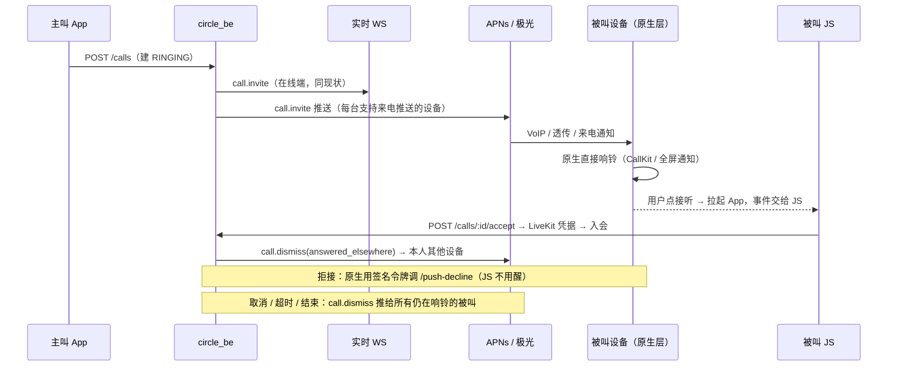

# 推送来电（App 在后台 / 未运行也能响铃）设计

日期：2026-10-26 · 状态：**已拍板并实现**（2026-10-26：D1 = A，D2–D4 按建议；D5 的 .p8 待用户提供。先上 TestFlight 测试）
涉及仓库：circle-im（前端，Expo SDK 55 / RN 0.83 新架构）、circle_be（NestJS / Prisma）

## 0. 背景与目标

现状：来电邀请**只**走实时 WebSocket。

- 后端 `src/call/call.service.ts` 建好 `CallSession` 后，对每个被叫调用 `realtime.broadcastCallInvite`；
- 前端 `src/realtime/client.ts` 收到 `call.invite`，交给 `use-call-store.ts` 的 `handleCallInvite`，再由 `CallInviteHost` 弹出应用内来电弹窗。

所以 App 被杀、iOS 挂起、安卓后台 60 秒后断开聊天 socket、或网络抖动时，电话根本不响。振铃窗口 45 秒（`CALL_RING_TIMEOUT_SECONDS`）过后，被叫只能看到一条「未接来电」记录。

目标：

- 被叫手机在后台或未运行时也像真电话一样响铃。
- 接听后进入 LiveKit 房间。
- 拒接、主叫取消、超时、在另一台设备上接听或拒接，都要让**每台设备**上的振铃界面消失。

非目标（本期不做）：

- 厂商推送通道（华为、荣耀、小米、OPPO、vivo）和 FCM。原因见 §1 D2。
- 安卓 `ConnectionService`（系统通话账户）。
- 后台断开实时连接（属于发热那条线的后续）。
- 给旧版本 App 补发「来电」普通通知。

## 1. 决策

> **拍板结果（2026-10-26）**：
> - **D1 = A**：先上 TestFlight，默认走 PushKit + CallKit。
> - **构建期开关**：`EXPO_PUBLIC_IOS_CALL_MODE=callkit|notification`，默认 `callkit`，留给将来的中国区 App Store 包。**不做运行时地区判断。** `notification` 模式的包把 CallKit / PushKit 整个编译出去，来电走 3B 的 time-sensitive 通知。见 §3B 的「实现」。
> - **D2–D4 按建议**：安卓本期只走极光长连接透传；推送带单通拒接令牌；推送里放主叫昵称（群通话再放群名）。
> - **D5**：.p8 由用户稍后提供。没配凭据时后端跳过 VoIP 推送，安卓透传照发。
> - **TestFlight 先测**：TestFlight 包走 APNs production，Xcode 调试包走 sandbox。为了让同一个后端同时服务两种包，由客户端登记 VoIP token 时上报环境（看包里有没有 `embedded.mobileprovision`），后端按 token 选主机，不用全局开关。

| # | 决策 | 选项 | 建议 |
|---|---|---|---|
| **D1** | **iOS 是否要上中国大陆区 App Store？** 2018 年起工信部要求中国区 App 停用 CallKit，审核会拒。iOS 13 起，PushKit 的 VoIP 推送**必须**上报给 CallKit，否则系统直接杀掉 App。所以在中国区，PushKit 和 CallKit 只能一起放弃。 | **A** 不上中国区：PushKit + CallKit，锁屏是系统来电界面，响到超时为止。<br>**B** 要上中国区：走「来电通知」，即高优先级（time-sensitive）APNs 通知 + 自带不超过 30 秒的铃声 + 「接听 / 拒绝」按钮，取消时用同一个 collapse-id 覆盖掉。<br>**C** 同一个包按地区开关 CallKit：有审核风险。 | 用户主要在中国，**选 B**，除非确定不上中国区。不建议 C。§3 的 A、B 两条都写了；**只实现选中的那条**。 |
| D2 | 安卓「App 已被杀」能覆盖到什么程度 | ① 本期只走极光自有长连接透传：App 进程或极光服务还活着就能全屏响铃（包括后台断开聊天 socket 之后）；国产 ROM 上划掉 App 后收不到。<br>② 再接厂商通道：每家都要开发者账号，「通话 / VoIP」类别要单独申请；而且厂商通知由系统绘制，只能横幅加铃声，没有全屏。 | 本期做 ①，② 另开任务。 |
| D3 | 设备未运行 JS 时，怎么把「拒接」告诉服务端 | ① 推送里带一个**只能拒接这一通**、到 `expiresAt` 失效的签名令牌，原生代码直接调用新增的免登录接口 `POST /calls/:id/push-decline`。<br>② 不带令牌：拒接只关掉本机界面，主叫要响满 45 秒，用户的其他设备也继续响。 | **选 ①**。这是新增的免登录接口，安全面见 §6。 |
| D4 | 推送里放不放来电人昵称 | ① 放主叫昵称；群通话再放群名。聊天推送本来就把发送者昵称和正文发给极光，所以隐私上没有新增。<br>② 只写「风信来电」。 | ①。头像、成员名单、LiveKit 房间和 token 一律不放。 |
| D5（仅 A） | APNs 凭据 | 需要你在 Apple Developer → Keys 建一个 APNs Auth Key（.p8），把 Key ID 和 Team ID 一起给我，写进后端环境变量。基于 token 的认证不需要单独的 VoIP 证书。 | 选 B 就不需要这一步：B 继续走极光现有的 APNs 配置。 |

## 2. 总体方案



原则：

1. **推送和 WS 并行，不互相替代。** 两条路都按 `callId` 去重，谁先到用谁。
2. **振铃界面由原生层自己画、自己收。** 原生层自带到期计时，即使撤销信令全丢，最晚 `expiresAt` 也会自己停。
3. **后端只给新版本客户端发来电推送。** 设备登记时要声明 `callPushVersion`，没声明的旧包行为和今天完全一样。
4. **尽力投递，和聊天推送同一哲学。** 不走 outbox、不重试。来电只有 45 秒，过期的推送没有价值，所以 TTL 等于剩余振铃秒数。

## 3. 原生模块选型（Expo prebuild）

| 方案 | 结论 |
|---|---|
| `react-native-callkeep` + `react-native-voip-push-notification` | **不选。** 两者都是旧架构桥接模块，而 RN 0.83 只有新架构，只能靠 interop 层勉强跑。PushKit 的回调必须在原生代码里**同步**上报 CallKit，需要改 AppDelegate；可 SDK 55 的 AppDelegate 是 Swift，社区插件改的是 ObjC 模板，prebuild 后对不上。callkeep 的安卓端是 `ConnectionService`，在国产 ROM 上问题多，也和「本期用通知」冲突。 |
| **仓库内本地 Expo 模块 `modules/call-push`**（Expo Modules API，Swift + Kotlin）+ 配置插件 `plugins/with-call-push.js` | **选这个。** 自动链接，`expo prebuild` 能直接生成，兼容新架构。iOS 用 `ExpoAppDelegateSubscriber` 在 `didFinishLaunching` 里注册 PushKit，不碰 AppDelegate 源码。安卓用 `ReactActivityLifecycleListener` 处理锁屏拉起，配置插件负责改清单、entitlements 和 Info.plist。估计原生代码 600–900 行，和 `with-ios-xcode27-compat`、`with-jpush` 是同一套路。 |

**改动后必须重新打原生包。** OTA 只换 JS，带不来这些能力（见 `docs/ota-updates.md`）。

### 3A. iOS — PushKit + CallKit（D1 = A）

- 启动时（包括被 VoIP 推送在后台冷启动的那一次），在 `didFinishLaunching` 里创建 `PKPushRegistry(.voIP)` 和一个全局唯一的 `CXProvider`。`CXProvider` 配置：`supportsVideo`；`maximumCallGroups = 1`；`includesCallsInRecents = false`，通话不进系统「电话 → 最近通话」，也就不会经 iCloud 同步；handle 类型为 `.generic`。
- `didReceiveIncomingPush`：`callId` 本身就是 UUID（`CallSession.id @default(uuid())`），直接当 CallKit UUID。
  - **在同一个回调里同步**调用 `reportNewIncomingCall`，并按 `expiresAt` 挂一个到期计时，到点以 `.unanswered` 结束。
  - 推送已经过期（迟到）时仍要先上报再立刻结束，这是 Apple 的硬规定。
  - 在 App 前台通过 WS 收到的邀请也交给 CallKit 上报，同一个 UUID 重复上报会返回 `callUUIDAlreadyExists`，天然去重。iOS 上从此只有一种来电界面，应用内弹窗只留给安卓和 Web。
- 接听（`CXAnswerCallAction`）：先存一条待处理动作，再发事件给 JS；JS 冷启动完成后会主动取走未处理动作。JS 拿到后接听并进入 LiveKit。
  - 音频会话要等 `provider(_:didActivate:)` 之后再交给 LiveKit，这是 CallKit 和 WebRTC 的标准接法，需要真机验证。
  - 视频来电在锁屏下接听时先只有音频，解锁回到 App 后再推摄像头，因为 iOS 不允许后台采集摄像头。
- 拒接（`CXEndCallAction`，此时尚未接听）：原生代码用推送里的 `declineToken` 调 `/push-decline`，同时通知 JS。通话中挂断则交给 JS 走现有的 `leaveCall`。
- **撤销信令不用 VoIP 推送。** 每一条 VoIP 推送都必须上报一通来电，用它发「取消」会让屏幕闪一下来电界面。CallKit 振铃期间 App 本来就在后台运行，所以 JS 会：
  - 确保 WS 连着，WS 会推来 `call.canceled`、`call.ended` 以及本人的 `participant.joined` / `participant.rejected`；
  - 每 5 秒查一次 `GET /calls/current` 对账，最多 9 次。
  
  任一路发现这通电话已经不在振铃，就结束 CallKit 通话。最差情况由原生到期计时兜底。
- Info.plist 的 `UIBackgroundModes` 加 `voip`（`audio` 已有）。entitlement 不变，现有的 `aps-environment` 已经够用。

### 3B. iOS — 来电通知（D1 = B，中国区合规）

- 后端经极光发**普通 APNs 通知**，字段：
  - `interruption-level: time-sensitive`，能穿透专注模式（需要 entitlement `com.apple.developer.usernotifications.time-sensitive`，由插件加上）；
  - `sound: call_ring.caf`，自带铃声不超过 30 秒，这是 iOS 通知铃声的上限；
  - `category: CALL_INVITE`；
  - `apns_collapse_id: call:<callId>`；
  - `time_to_live` 等于剩余振铃秒数。
- `CALL_INVITE` 类别注册两个按钮：「接听」（foreground：拉起 App，由 JS 接听）和「拒接」（不拉到前台：原生用 `declineToken` 调 `/push-decline`）。按钮回调要挂进 expo-notifications 和极光已经占用的 `UNUserNotificationCenter` 代理链，具体挂法实现时确认。
- 撤销：用同一个 collapse-id 发一条**静音**通知（「对方已取消通话」「未接来电」「已在其他设备接听」），覆盖掉原来那条。替换是否会立刻停掉还在播放的铃声，**必须真机验证**。不行就退回「不超过 30 秒、自然结束」。
- 体验上限：锁屏只是一条横幅加 30 秒铃声，没有系统通话界面。这是中国区所有 IM 共同的天花板。

**实现（构建期开关 `EXPO_PUBLIC_IOS_CALL_MODE=notification`）**：
- 构建：
  - `app.config.js` 校验开关取值，通知模式要求同时配置极光；
  - `with-call-push` 插件不加 `voip` 后台模式，改加 time-sensitive entitlement，并在 `Podfile.properties.json` 写入 `callPush.iosMode`；
  - podspec 据此加上编译条件 `CALL_PUSH_NO_CALLKIT`，不链接 CallKit / PushKit。CallKit 实现整份包在条件编译里，另有一个同 API 的空实现，作用是按 collapse-id 收掉通知中心里的来电通知；
  - 铃声 `assets/sounds/call_ring.caf` 是自合成的 28 秒铃声，只有通知模式的包会通过 expo-notifications 的 `sounds` 打进去。
- 后端：iOS 极光 token 声明了 `callPushVersion`，就发 time-sensitive 来电通知。只有通知模式的包会声明；CallKit 包的 iOS 极光 token 从不声明，所以同一台设备不会两边都响。
- 接听与拒接：
  - **本期没有通知上的「接听 / 拒绝」按钮**。点开通知后，JS 从极光的 `notificationOpened` 事件拿到邀请，补出应用内来电弹窗，在弹窗里接听或拒接；
  - App 活着时，收到撤销通知会收掉弹窗。
- ⚠️ 上线中国区包之前要确认三件事：
  - 极光 REST API 会把 `interruption-level` 透传给 APNs；
  - 静音覆盖能不能停掉正在播放的铃声；
  - Apple 对中国区包里 PushKit 的审核口径。

### 3C. 安卓 — 极光透传 + 全屏来电通知

- 后端对安卓设备发极光**自定义消息（透传，`message` 字段）**，不发 `notification`。极光 SDK 不会替我们显示透传消息，由我们的原生代码决定怎么画。
- **接收端。** `jpush-react-native` 的 `JPushModuleReceiver` 是唯一收 `RECEIVER_MESSAGE` 的组件。配置插件在合并后的清单里用 `tools:node="remove"` 去掉它，换成我们的 `CallJPushReceiver extends JPushModuleReceiver`。新接收端只截获 `type` 为 `call.*` 的透传，其余全部 `super` 回原逻辑，所以现有的 JS 监听和通知点击行为一字不变。
- **来电通知。**
  - 通知渠道 `incoming_call`：`IMPORTANCE_HIGH`，铃声取 `RingtoneManager.TYPE_RINGTONE`（`USAGE_NOTIFICATION_RINGTONE`），带震动。
  - 通知本身：`NotificationCompat.CallStyle.forIncomingCall`；`CATEGORY_CALL`；`setFullScreenIntent`，锁屏或亮屏时直接拉起来电界面；`FLAG_INSISTENT` 让铃声循环；`setTimeoutAfter(expiresAt - now)` 到期自动消失。
  - App 正在前台时不发通知，交给 WS 和现有弹窗。如果振铃中途切到后台，JS 让原生补发这条通知。
- **接听。** 用 `PendingIntent.getActivity` 拉起 MainActivity。安卓 12 起禁止用广播做跳板，所以必须直接拉 Activity。原生层把 `showWhenLocked` 和 `turnScreenOn` 打开，并存一条待处理动作；JS 启动后取走，走和弹窗相同的 `acceptCall` → `/(chat)/group-call` 流程。
- **拒接。** 交给 `BroadcastReceiver`：收掉通知、停铃，再用 `declineToken` 调 `/push-decline`（OkHttp）。
- **撤销。** 后端发透传 `call.dismiss`，接收端收掉对应 `callId` 的通知。原生层另外记一份最近撤销过的 `callId`（最多 20 条，按 `expiresAt` 过期），防止「撤销先到、邀请后到」的乱序。邀请到达时如果 `expiresAt` 已过，直接丢弃。
- **权限。**
  - 清单加 `USE_FULL_SCREEN_INTENT`。安卓 14 起只有 Google Play 会在安装时收回这项权限；我们走 GitHub 发 APK、不经过 Play，默认是授予的。
  - 被用户关掉时，系统自动降级成横幅通知（仍然响铃）。原生模块已提供 `canUseFullScreenIntent()` 和 `openFullScreenIntentSettings()`，但设置页的提示入口**本期没做**，留作后续。
- **覆盖范围（D2 ①）。** 只要极光长连接还活着就能收到，包括后台断开聊天 socket 以后，因为极光连接和聊天 socket 是两条独立的连接。国产 ROM 上划掉 App 后长连接被杀，透传会在 TTL 内连接恢复时补到，过期就丢弃。

## 4. 后端

### 4.1 凭据

- 极光：沿用 `JPUSH_APP_KEY`、`JPUSH_MASTER_SECRET`、`apns_production`，不新增。
- 仅 D1 = A 需要 APNs VoIP 凭据：
  - 新增 `APNS_KEY_ID`、`APNS_TEAM_ID`、`APNS_PRIVATE_KEY`（.p8 的 PEM 内容）、`APNS_TOPIC`（默认 `com.yiboding.circleim.voip`）、`APNS_PRODUCTION`（与 `JPUSH_APNS_PRODUCTION` 同义：开发包用 sandbox，TestFlight 和 App Store 用 production）；
  - 用 Node 自带的 `http2` 发请求；JWT 用 `crypto.sign` 做 ES256，缓存 50 分钟（Apple 要求刷新间隔在 20 到 60 分钟之间）；**不加新依赖**；
  - 没配凭据时跳过 VoIP，启动时打一条 warn，和极光「没配就跳过」一样。
- 拒接令牌密钥：用 HKDF 从现有的 `SECRET` 派生（info 为 `call-push-decline-v1`），不新增运维变量。如果你希望和 `SECRET` 分开轮换（像 `TEMP_CHAT_LINK_SECRET` 那样），就改成可选的 `CALL_PUSH_ACTION_SECRET`。

### 4.2 设备登记（`DevicePushToken`）

- 新增一个 provider 值 `apns_voip`（仅 iOS，十六进制 token），复用现有的 `/notification/push-token` 登记、吊销和墓碑流程。前端新开一个独立的登记实例，使用自己的存储键。
- 新增列 `callPushVersion Int?`。新客户端登记极光 token 时带 `callPushVersion: 1`，`apns_voip` 也是 1；旧客户端为 null，**收不到任何来电推送**。
- 聊天和通知推送的查询本来就只认 `provider IN ('expo','jpush')`，`apns_voip` 天然不会被卷进去。
- 来电目标查询：先取被叫的活跃 token，条件是 `disabledAt IS NULL AND callPushVersion >= 1`，provider 为 `apns_voip`，或者是 `jpush` 且平台为安卓（选 B 时也包括 iOS）；然后每人每个 provider 只取最近的 5 个。

### 4.3 推送载荷（v1）

所有字段都是字符串，方便极光 `extras` 透传：

```jsonc
{
  "v": "1",
  "type": "call.invite",            // 或 "call.dismiss"
  "callId": "<uuid>",
  "callType": "AUDIO",              // AUDIO | VIDEO
  "sessionType": "single",          // single | group
  "callerId": "<uuid>",             // CallKit 的 handle；不显示给用户
  "callerName": "小明",              // D4；截断到 32 字
  "groupName": "周末羽毛球",          // 仅 group，可空
  "expiresAt": "2026-10-26T12:00:45.000Z",
  "declineToken": "v1.<userId>.<exp>.<base64url-hmac>"   // D3
}
// call.dismiss 只有 v/type/callId/reason
// reason ∈ canceled | ended | missed | answered_elsewhere | declined_elsewhere | failed
```

各通道怎么投递：

- APNs VoIP：`apns-push-type: voip`、`apns-priority: 10`、`apns-expiration` 设为 `expiresAt` 的秒数，载荷体为 `{"call": {…}}`。
- 极光安卓：`message.msg_content = type`、`message.extras = 上表`，`options.time_to_live` 等于剩余振铃秒数（至少 1）。
- 极光 iOS（B）：在 `notification.ios` 里写 `alert`、`sound`、`category`、`interruption-level`、`extras`，`options.apns_collapse_id` 为 `call:<callId>`。

### 4.4 发送时机（全部挂在事务提交之后，不阻塞接口；失败只记日志、计指标）

| 事件 | 现有位置（`call.service.ts`） | 推送 |
|---|---|---|
| 发起 | 邀请广播之后 | `call.invite` → 全部被叫 |
| 主叫取消 | `cancelCall` | `call.dismiss(canceled)` → 仍在 INVITED 的被叫 |
| 超时 | `expireRingingCallAsMissed`、`sweepExpiredRingingCalls` | `dismiss(missed)` → 同上 |
| 被叫接听 | `joinInvitedCall` | `dismiss(answered_elsewhere)` → **本人**的全部设备 |
| 被叫拒接 | `rejectCall`（新的 `/push-decline` 也走这里） | `dismiss(declined_elsewhere)` → 本人设备；如果因此整通结束，再按 `ended` 发给其余被叫 |
| 结束或失败 | `endRingingCallIfNoInviteesRemain`、`failRingingCallAsError`、LiveKit 回调 | `dismiss(ended/failed)` → 仍在 INVITED 的被叫 |

新增 `src/call/call-push.service.ts`（`CallPushService`），提供 `ringInvitees` 和 `dismiss` 两个方法。

- 实际发送复用 `NotificationPushService`：极光部分新增一个「透传」批量方法，沿用现有的鉴权、1000 个一批的切分、死 token 停用和 `recordPushDelivery` 指标。
- APNs 部分新增 `ApnsVoipClient`：返回 410 `Unregistered` 或 400 `BadDeviceToken` 时停用 token，其余错误只记一次，不重试。

### 4.5 `POST /calls/:id/push-decline`（D3）

- 免 JWT，按 IP 限流每分钟 10 次。请求体为 `{ token }`。
- 校验：HMAC 用 `timingSafeEqual` 比对，令牌里的 `callId` 必须与路径一致，`exp` 不得早于当前时间（`exp` 就是该通电话的 `expiresAt`）。
- 通过后调用现有的 `rejectCall(userId, callId)`。已经拒接过、或已不在 INVITED 状态时，按幂等处理返回 204；令牌无效返回 401。
- 令牌**只能拒接这一通、只代表这一个人、45 秒内有效**：不能接听，不能读取任何数据。

## 5. 前端（JS 侧）

- `modules/call-push`：对 JS 暴露这些能力：
  - `getVoipToken`；
  - `consumePendingActions`；
  - `reportIncomingCall`（iOS-A）；
  - `showIncomingNotification` 和 `dismiss(callId)`（安卓）；
  - `canUseFullScreenIntent` 和 `openFullScreenIntentSettings`；
  - `configure({ apiBaseUrl })`，告诉原生层拒接请求发到哪个服务端地址。

  Web 端和没装原生模块的包都是空实现。
- `src/features/call/push/`：
  - 解析并校验原生事件，与 `realtime-guards.ts` 同风格；
  - `useCallPushBridge` 挂在 `CallInviteHost`；
  - 把接听流程从 `CallInviteHost` 抽成可复用的 `acceptIncomingCall`；
  - iOS 振铃期间的对账轮询。
- `use-call-store.ts`：
  - `handleCallInvite` 按 `callId` 去重，忽略最近已结束的 `callId`；
  - 收到**本人**的 `participant.joined` 或 `participant.rejected`，而且不是本机发起的，就收起本机来电并调用原生 `dismiss`。这也顺手修掉一个现存的多设备 bug：今天另一台设备接听后，本机弹窗不会关。
- 推送登记：
  - iOS-A 增加一个 `apns_voip` 登记实例；
  - 极光登记带上 `callPushVersion: 1`；
  - 退出登录和切换账号时一并吊销。
- 新增文案走 i18n 五种语言：通知渠道名、全屏权限提示、「通话已取消」等。

## 6. 隐私与安全

- **推送里会出现的：** `callId`、通话类型、主叫昵称和群名（D4）、到期时间，以及拒接令牌（只能拒接这一通，45 秒后失效）。
- **推送里不会出现的：** 头像 URL、成员名单、手机号、LiveKit 房间名和 token、会话 ID、消息内容。
- 极光是第三方（会经过它的服务器），APNs 是 Apple，二者都已经在聊天推送里承载同等级别的数据。
- `includesCallsInRecents = false`：通话不写进系统通话记录，也就不会经 iCloud 同步。安卓通知设 `VISIBILITY_PRIVATE`，锁屏上只显示「风信来电」，解锁后才显示名字。
- 日志和 Sentry 只记 `callId`、事件、provider 和结果，**不记 token 和昵称**，沿用现有的推送日志规则。
- `/push-decline` 是新增的匿名入口：做了限流；令牌带 HMAC 并绑定用户、通话和过期时间；不论成功失败都只返回 204 或 401，不暴露通话状态，避免被当成探测接口。

## 7. 边界情况

- 推送迟到：VoIP 推送靠 `apns-expiration`，极光靠 `time_to_live`，原生层再检查一遍 `expiresAt`。三层保证过期的来电不响。
- 推送和 WS 都到达：按 `callId` 去重。iOS 上由 CallKit 的 UUID 去重；安卓前台不发通知。
- 被叫正在别的通话中：沿用现状，后端 `assertNotBusy` 会拒。iOS 正在打蜂窝电话时，CallKit 会显示呼叫等待。
- 已退出登录：token 已经吊销，收不到推送。万一吊销前推送已经发出，接听会因为没有会话而失败，结果是收起来电并提示需要登录。
- 用户关了通知权限或全屏权限：安卓降级成横幅通知或什么都不显示，设置页给出提示。iOS-A 的 VoIP 推送不受通知权限影响。

## 8. 测试

后端（jest）：

- 载荷字段白名单：断言没有头像、token、房间名。
- TTL 和 `apns-expiration` 的计算。
- 目标筛选：旧 token 没有 `callPushVersion` 时不发。
- §4.4 每条路径都只发一次正确的 dismiss。
- 拒接令牌：篡改、过期、换通话、换用户都要被拒。
- `/push-decline` 的 HTTP spec，包括幂等和限流。
- 极光透传请求体的形状。
- APNs 客户端：JWT 缓存、410 停用 token。
- 迁移 spec。

前端：

- node:test：载荷校验、store 去重和本人多设备收起、`with-call-push` 插件改写清单（包括 `JPushModuleReceiver` 被替换）和 Info.plist。
- jest（`*.spec.tsx`）：原生接听事件 → `acceptCall` → 路由跳转；拒接事件；iOS 对账轮询会停止。
- **原生代码进不了 CI 单测**，靠下面的真机清单验收；PR 里会附上这份清单。

真机清单（每条在 前台 / 后台超过 60 秒 / 锁屏 / 划掉 App 四种状态下各测一遍）：

1. 来电响铃并显示主叫昵称，视频来电标明是视频。
2. 接听后进入通话，双方都有声音；视频来电解锁后能推出摄像头。
3. 拒接：主叫立刻看到已拒接，同账号的另一台设备停止响铃。
4. 主叫取消：被叫停止响铃。
5. 45 秒超时：被叫自己停止响铃，并留下未接记录。
6. 在 A 设备接听：B 设备停止响铃。
7. 断网时来电、在振铃窗口外恢复网络：不会补响。
8. 旧版本包：行为和今天完全一样。
9. 安卓 14 关掉全屏权限：降级为横幅，设置页有提示。

## 8.5 审查后补上的行为（2026-10-27）

- **冷启动期间来电已经结束**（主叫取消、别处已接）：WS 不会重放这些事件。JS 处理 `incoming` 时向服务端确认，确定不再邀请我，就收掉 CallKit；问不到（网络差）则不动，交给到期计时。iOS 原生层另外记住最近结束的通话，迟到的 VoIP 推送上报后立刻结束。
- **本机正在接听时**，对账结果和「已在其他设备接听」撤销都不能把这通收掉（服务端此时已把我记成 JOINED）；只有接听本身失败才收。
- **CallKit 拒绝上报**（勿扰过滤等）：原生层发 `unavailable`，应用内弹窗兜底，不让主叫白响。
- **未登录时收到来电**（token 撤销还在排队）：原生事件一律收掉，CallKit 不会一直挂在「已接通」。
- **安卓锁屏**：只有「接听」会让 App 显示在锁屏之上。全屏来电 / 点通知只补出应用内弹窗，不越过锁屏，否则 JS 还没把弹窗拿出来之前，整个 App 都能在不解锁的情况下操作。拒接和撤销时原生层自己放开锁屏显示。
- **安卓前台收到透传时原生层不响**（`shown=false`），切到后台后由 JS 补发通知。
- **APNs 长连**：请求超时或流提前断开时丢弃会话并重连，避免一条半开连接拖住之后的每一通来电。
- **极光 1003**（参数不合法）：在来电路径上不再当作死令牌，否则新载荷字段一旦被判不合法，就会把被叫的极光 token 全部停掉，聊天推送一起断。

## 9. 实现对照（2026-10-26）

- 后端（circle_be `feat/push-incoming-calls`）：
  - `src/call/call-push.service.ts`：邀请、撤销、目标筛选；
  - `src/notification/apns-voip.client.ts`：http2 + ES256，按 token 选择环境；
  - `src/call/call-decline-token.ts`、`call-push.controller.ts`：`/push-decline` 接口；
  - 迁移 `20261026120000_call_push_tokens`。
- 前端原生（`modules/call-push`，本地 Expo 模块，由 `plugins/with-call-push.js` 改清单和 Info.plist）：
  - iOS：`CallPushCenter.swift`，PushKit + CallKit + 原生拒接；
  - 安卓：`CallJPushReceiver`（继承极光接收端）、`IncomingCallNotifier`（CallStyle 全屏通知）、`CallActionReceiver`（拒接）。
- 前端 JS（`src/features/call/push/`）：
  - `use-call-push-bridge.ts`：原生事件与 store 双向同步；
  - `incoming-call-actions.ts`：接听、拒接、恢复，弹窗与原生界面共用；
  - `use-ringing-call-watchdog.ts`：后台振铃时对账；
  - `voip-token-registration.ts`：单独登记 VoIP token。

## 10. 交付划分

- 两个仓库使用同名分支 `feat/push-incoming-calls`，各开一个 PR。
- 后端 PR 可以先合：旧客户端从不声明 `callPushVersion`，所以零影响。
- 前端 PR 的描述里注明「**需要重新打原生包**」，并附上 §8 的真机清单。
- 部署：后端配好凭据（A 需要 APNs，B 沿用极光）→ 合后端 → 打新的原生包 → 真机验收。
